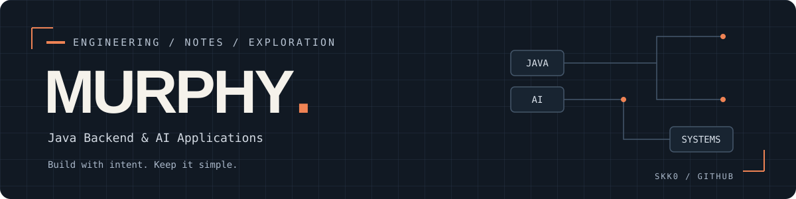

  

### 你好，我是 Murphy

一名 Java 后端开发者，正在探索 AI 应用与智能体工程。  
喜欢把复杂问题拆清楚，把想法做成可运行、可维护的系统。

`Java` · `Spring Boot` · `Spring AI` · `LLM` · `MCP`

### 关注的方向

| 方向 | 持续探索 |
| :--- | :--- |
| **Backend** | Java / Spring 生态，业务系统设计与工程实践 |
| **AI Applications** | Spring AI、智能体、工具调用与知识检索 |
| **Build & Learn** | 在项目中验证想法，用代码与笔记沉淀经验 |

---

保持好奇，持续构建。 · Stay curious. Keep building.
